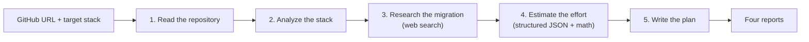

# StackShift

**Plan a tech stack migration from your real code.** Point StackShift at a GitHub repository and tell it where you want to go, say "Next.js 16 with TypeScript". It reads the repository, researches the migration on the web, estimates the effort, and writes a phase-by-phase plan your team can follow.

Built with Next.js 16, TypeScript and Claude (Opus 5.5).

## What you get

Four reports, shown in the browser and downloadable as Markdown:

| Report | What's in it |
| --- | --- |
| **Current stack** | Languages, frameworks and versions taken from the real manifests, how the code is organized, and what will port easily or not |
| **Migration research** | The recommended path, official guides and tools, and common problems, with links to sources |
| **Effort estimate** | Work items in hours, total effort and cost, calendar time for teams of 1, 3 and 5, plus risks and assumptions |
| **Migration plan** | Phases with concrete tasks, testing and rollback, team roles, and a first-week checklist |

## How it works



1. **Read the repository (code, no AI).** StackShift uses the GitHub API to fetch the file tree, the README, every manifest (`package.json`, `requirements.txt`, `go.mod`, `pom.xml` and more), config files, entry points and the largest source files, up to 40 files. It measures the repository: file counts, estimated lines of code, languages, and the frameworks and versions listed in the manifests.
2. **Analyze the stack (Claude).** Claude reads that snapshot and describes the current stack. It is told to treat the measured facts as ground truth and to say "unknown" rather than guess.
3. **Research the migration (Claude with web search).** Claude searches for official guides, codemods and real migration stories for this stack and target, and the report lists its sources.
4. **Estimate the effort (Claude, then code).** Claude breaks the work into items and sizes each in hours, returning JSON that must match a schema. StackShift then does the math: it adds a 20% contingency, applies your hourly rate, and converts hours into calendar weeks for teams of 1, 3 and 5.
5. **Write the plan (Claude).** Claude turns everything into a phase-by-phase plan.

Every step receives the earlier reports in full. Progress streams to the browser as it happens, and cancelling stops the API calls too.

## Quick start

You need Node.js 22.12 or newer, and an [Anthropic API key](https://console.anthropic.com).

```bash
git clone https://github.com/mohitzaveri/stackshift.git
cd stackshift
npm install
cp .env.example .env.local   # then add your ANTHROPIC_API_KEY
npm run dev
```

Open http://localhost:3000.

No API key yet? Try demo mode. The repository is still read for real, but the AI steps return clearly labeled placeholders:

```bash
DEMO_MODE=1 npm run dev
```

## Configuration

Set these in `.env.local` (see `.env.example`):

| Variable | Default | What it does |
| --- | --- | --- |
| `ANTHROPIC_API_KEY` | none | Required for real analyses |
| `GITHUB_TOKEN` | none | Raises GitHub's limit from 60 to 5,000 requests per hour, and allows private repositories |
| `CLAUDE_MODEL` | `claude-opus-5-5` | The Claude model to use. `claude-sonnet-5-5` also works; older models lack some features StackShift uses. |
| `CLAUDE_EFFORT` | `high` | Effort for the analysis, estimate and plan steps (`low`, `medium`, `high`, `xhigh`, `max`). Research runs at `medium`. |
| `DEMO_MODE` | off | `1` runs without AI and returns placeholder reports |
| `ACCESS_CODE` | none | If set, visitors must enter this code to run an analysis |
| `RATE_LIMIT_PER_HOUR` | `5` | Analyses per visitor per hour. `0` means unlimited. |

## Cost

Each analysis makes four Claude requests and up to six web searches. The exact token count and cost, at list prices, are shown at the end of every run. Some notes on keeping it down:

- The repository snapshot is sent with prompt caching, so the estimate and plan steps re-read it at a fraction of the price.
- `CLAUDE_EFFORT=medium` uses less thinking per step. A cheaper model, such as `CLAUDE_MODEL=claude-sonnet-5-5`, also works.

If Claude's safety filters decline a step, the request is retried on a fallback model automatically (server-side fallbacks).

## Deploying

StackShift is a standard Next.js app, so any Node.js host works (Render, Railway, Fly.io or your own server):

```bash
npm run build
npm start
```

Things to know:

- An analysis takes a few minutes and streams over one long HTTP response. Hosts with short request timeouts, such as some serverless plans, can cut it off.
- If the app is public, set `ACCESS_CODE` and keep `RATE_LIMIT_PER_HOUR` low, because every run is paid for with your API key.
- The rate limiter is kept in memory, so the limit applies per server instance.

## Development

```bash
npm test           # unit tests (Vitest); no network or API key needed
npm run typecheck  # TypeScript
npm run build      # production build
```

```
app/
  page.tsx               the UI: form, live progress, results
  api/analyze/route.ts   runs an analysis and streams progress as NDJSON
  api/health/route.ts    server settings for the UI (no secrets)
components/              form, progress view, result view, Markdown renderer
lib/
  github.ts              parses URLs, fetches the repository, picks files, builds the snapshot
  detect.ts              file classification, framework detection, size estimates
  llm.ts                 Claude client: streaming, web search, pause and resume, usage
  prompts.ts             instructions for the four AI steps
  estimate.ts            estimate schema, plus all effort, cost and timeline math
  pipeline.ts            runs the five steps in order
  demo.ts                the no-AI demo client
tests/                   unit tests with fake GitHub and Claude responses
```

## Limitations

- StackShift reads at most 40 files (about 160K characters) per repository, so very large repositories are sampled rather than read in full. The snapshot always lists which files were read.
- Estimates are grounded in the measured size of the code, but they are still estimates: a starting point for planning, not a quote.
- History is saved in your browser only. There are no accounts yet.
- GitHub only, for now.

## Ideas for later versions

- Saved, shareable reports (database and sign-in)
- Background jobs, so an analysis survives a closed tab
- Comparing two target stacks side by side
- PDF export
- GitLab and Bitbucket support

## License

[MIT](LICENSE)
